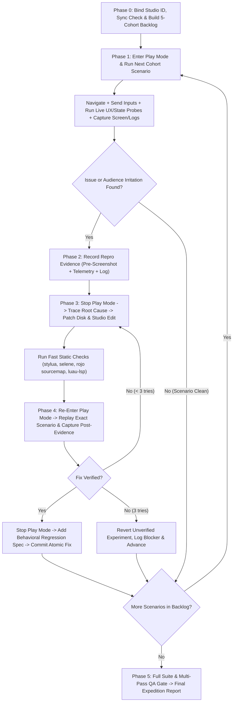

# Roblox autonomous playtest, UX friction hunter, and closed-loop fixer

Static linters and mocked unit specs verify code structure, but they cannot feel an unresponsive jump-to-flight transition, a modal button that accidentally fires a combat ability underneath, a porch step that snags a character's feet, a skip button hidden behind Roblox's `PlayerList`, or a phase timer that bores a 9-year-old into leaving.

This skill runs **long, self-sustaining playtest-and-fix expeditions** directly inside Roblox Studio. It plays the game through the eyes and hands of its target audience, systematically uncovers functional bugs and irritating control/configuration friction, fixes the root cause in source, verifies the fix in live Play mode, locks in a regression test, and continues to the next gameplay cohort.

---

## 1. Iron laws of autonomous playtest & fix

1. **No fix without live playtest evidence**: Before editing code for any gameplay, control, UI, or pacing issue, reproduce it in Studio Play mode (`start_stop_play(is_start: true)`) and capture concrete before-evidence: the exact input/navigation sequence, console output (`get_console_output`) or live telemetry probe result (`execute_luau`), and a viewport capture (`screen_capture`).
2. **Never edit scripts while Play mode is running**: Play mode (`Client` / `Server` DataModels) is ephemeral. Always stop Play mode (`start_stop_play(is_start: false)`) and confirm `datamodel_type: "Edit"` via `get_studio_state` before applying code changes.
3. **Zero drift between disk and Studio**: In Rojo or Script Sync repositories (such as projects with `default.project.json` and `src/`), apply fixes to the tracked files on disk **and** mirror them to the Studio `Edit` DataModel (via `multi_edit` when live sync is not running) so git and Studio stay identical.
4. **Keep going across the whole expedition**: Do not stop after fixing a single bug. Maintain an active **Playtest Ledger** and work continuously through all five playtest cohorts until the expedition backlog is clean or a hard stop condition is reached.

---

## 2. Harness-agnostic Studio MCP tool contract

This skill works identically across Claude Code, Codex CLI, Antigravity (`agl`), OpenClaw, and Cursor using the official `Roblox_Studio` MCP server:

| Phase / Action | MCP Tool | Required `datamodel_type` & Discipline |
|---|---|---|
| Discover Studio window | `list_roblox_studios` | Run first; record `studio_id` and `placeId` and pass `studio_id` on every call. |
| Check mode & DataModels | `get_studio_state` | Confirm `"Edit"` before editing; confirm `"Client"` and `"Server"` after starting Play. |
| Enter / exit Play mode | `start_stop_play` | `is_start: true` to play; `is_start: false` to return to Edit mode before patching. |
| Traverse world paths | `character_navigation` | `"Client"`. Navigate by `instance_path` or `x, y, z` to test real physical pathing and collisions. |
| Simulate keyboard/gamepad | `user_keyboard_input` | `"Client"`. Ordered `keyPress`, `keyDown`, `keyUp`, `textInput`, and `wait` actions. |
| Simulate mouse/touch UI | `user_mouse_input` | `"Client"`. Ordered `moveTo`, `mouseButtonClick`, `mouseButtonDown`, `mouseButtonUp`, `scrollUp/Down`, `wait`. |
| Inspect live state & probe | `execute_luau` | `"Client"` (UI, input, camera, local feel), `"Server"` (phases, enemies, authority), or `"Edit"` (unit suites). |
| Visual evidence | `screen_capture` | Pass descriptive `capture_id` and optional player-eye `camera_position` / `look_at_position`. |
| Runtime error check | `get_console_output` | Read after every state transition and input sequence to catch stack traces and warnings. |
| Patch Studio scripts | `multi_edit`, `script_read` | `"Edit"` only. Mirror every disk edit into Studio if Rojo live sync is not active. |

Read [references/playtest-probes.md](references/playtest-probes.md) for ready-to-run `execute_luau` probes that measure control friction, UI/CoreGui collisions, traversal snags, camera occlusion, and pacing bottlenecks during Play mode.

---

## 3. Target-audience irritation & control friction matrix

When playing each cohort, evaluate the experience through two lenses: **functional bugs** (errors, desyncs, broken mechanics) and **target-audience irritation** (controls, camera behaviors, UI layouts, and tuning configurations that frustrate players, especially kids aged 7–12 across mobile, tablet, gamepad, and keyboard).

### A. Control & input irritations ("Why didn't my button work?!")

| Friction Pattern | What to Test in Play Mode | How to Fix It |
|---|---|---|
| **Compound or fussy activation** | Hold or press primary movement/combat keys (`Space` to fly, `E` to burst, `H` to howl, `Q` to blink) from a standstill, mid-run, and mid-jump. Check if the game forces an awkward prerequisite (such as jumping before holding `Space` to fly). | Allow single-intent activation from the ground (e.g., grounded takeoff lift + coyote window `80–120 ms` + input buffering `100–150 ms`). |
| **Modal vs. gameplay input bleed** | While a modal, storybook intro, tutorial card, or shop is open, press `Space`, `E`, `H`, `ButtonA`, `ButtonX`, `ButtonB` and click modal buttons. Watch whether gameplay abilities fire underneath the UI or whether invisible `Active = true` frames block camera drag. | Gate gameplay input bindings behind modal-open state or `ContextActionService:BindActionAtPriority` with `Enum.ContextActionResult.Sink` when a modal captures focus. |
| **Swallowed holds & stuck states** | Hold a charge/flight/pour button while moving the mouse/thumbstick (`Enum.UserInputState.Change`), then release rapidly or trigger a respawn. Check if the hold cancels prematurely or gets stuck active. | Ignore `UserInputState.Change` inside hold handlers; never rate-limit or alive-gate `Stop`/`Release` remotes on the server; clear all holds on `CharacterRemoving` and `Humanoid.Died`. |
| **Unforgiving aiming & dead presses** | Trigger attacks and teleports near enemies without pixel-perfect cursor placement, and press abilities while on cooldown or at `0` charge. | Add forgiving cone/proximity target assist with camera-forward raycast fallback on touch/gamepad; add immediate empty-charge/cooldown feedback (UI shake, ghost bar flash, soft dry-click SFX). |
| **Mismatched prompts & wrong device glyphs** | Compare every visible HUD label, tutorial step, and billboard prompt against the actual code binding and current `UserInputService.PreferredInput` (`Keyboard`, `Gamepad`, `Touch`). | Bind prompt text reactively to `PreferredInput` changes and single-source ability action copy from shared config so tutorial hints never contradict live mechanics. |

### B. Camera, movement & spatial irritations ("I'm stuck / I can't see!")

| Friction Pattern | What to Test in Play Mode | How to Fix It |
|---|---|---|
| **Doorway & threshold snags** | Use `character_navigation` and simulated movement across every doorway (`DogDoor`), porch step, bridge, stepping stone, and hub-to-objective desire line. Run the **Traversal Snag Probe** to detect where `MoveDirection.Magnitude > 0.5` but horizontal speed drops near `0`. | Keep walkable step risers `<= 0.4` studs (or add invisible sloped ramp colliders) and set `CanCollide = false`, `CanTouch = false`, `CanQuery = false` on all decorative micro-props (`< 0.65` studs). |
| **Rubber-banding & false fall recovery** | Trigger maximum vertical takeoff, dash down slopes, and jump off high ledges. Watch if server speed/climb checks snap the character back or if fall/void recovery teleports a player during a normal finite jump. | Align server velocity/climb envelopes above peak client takeoff/dash impulses with grace windows, and require sustained downward out-of-bounds thresholds before triggering fall recovery. |
| **Camera floor-drag & foliage pop** | Move through dense trees, doorways, and tight caves with a small/quadruped rig. Check if the camera drags on the ground, clips inside the character, or snaps violently when passing props. | Tune scale-aware `Humanoid.CameraOffset` (`Y = 1.2–1.8` studs + forward look-ahead), clamp `CameraMinZoomDistance` (`>= 6` studs), and set `CanQuery = false` on foliage, VFX, and overhead beams. |

### C. Pacing, UI & configuration irritations ("I'm bored / What do I do?!")

| Friction Pattern | What to Test in Play Mode | How to Fix It |
|---|---|---|
| **Slow time-to-first-fun & timer drags** | Measure seconds from join to first character movement and signature action (`< 30s` target). Time phase transitions and post-round summary screens (`Home` phase) after all actions are complete. | Make intro sequences immediately skippable with a clear button; shorten passive end-of-phase summary timers once objectives are banked; keep lobby players free to move and practice abilities. |
| **CoreGui & mobile thumbzone collisions** | Run the **UI & CoreGui Collision Probe** across phone (`844x390`, `390x844`), tablet (`1024x768`), and desktop (`1920x1080`). Check if top-right buttons collide with Roblox's `PlayerList`, top-left buttons hit `GuiService:GetGuiInset()`, or bottom-right buttons overlap the mobile Jump button. | Offset top-right HUD/skip controls clear of the `PlayerList` footprint, respect `GuiService:GetGuiInset()`, arrange mobile buttons in a right-thumb arc clear of `TouchGui` Jump, and enforce `>= 48x48` px touch targets. |
| **Banner pile-ups & visual noise** | Trigger a tutorial step, a phase transition toast, and an urgent status banner (e.g., stolen voice or low charge) simultaneously. Check `Highlight` instance count (`<= 31` engine cap). | Suppress or dock lower-priority tutorial cards while an urgent survival banner is visible; pool temporary `Highlight` flashes and destroy them on tween completion. |
| **Untelegraphed damage & solo slog tuning** | Fight enemies and bosses solo (`1` player) and in scaled co-op (`2–8+` players). Check whether enemy strikes give a fair `0.4–0.8s` visual+audio telegraph and whether wave counts or boss health feel tedious solo. | Add clear ground/tether telegraphs before damage lands; verify `TeamScale` scales solo/small-group targets down (`0.5` solo) and shrinks remaining thresholds if a teammate disconnects. |

---

## 4. The long-run marathon workflow

When invoked to review, playtest, and improve a game, execute this multi-cohort loop autonomously. Do not stop after one finding; cycle through all cohorts until the expedition is complete.



### Phase 0: Session setup, sync check, and expedition backlog

1. **Bind Studio**: Call `list_roblox_studios` and `get_studio_state`. Confirm the target `studio_id` and `placeId`.
2. **Verify source-to-Studio parity**: If the workspace has disk source (`src/` or `game/src/`), run a fast parity check in `Edit` mode (`execute_luau`) or compare recent modified scripts with `script_read` to confirm Studio's `Edit` DataModel matches disk source before starting.
3. **Initialize the 5-Cohort Expedition Backlog**: Tailor these five cohorts to the game's specific loop and record them in your working **Playtest Ledger**:
   - **Cohort 1 — Arrival, Onboarding & First 60 Seconds**: Spawn in lobby, intro/storybook flow, skip controls, character/class picker, tutorial step progression, first transformation/suit equip, and HUD legibility across viewports.
   - **Cohort 2 — 3Cs: Locomotion, Camera & World Traversal**: Ground movement, deceleration, slope alignment, doorway/porch step traversal (`character_navigation`), jump/coyote time, flight takeoff/cruise/landing, dash/teleport aiming, and camera framing/occlusion.
   - **Cohort 3 — Combat, Abilities & Cross-Platform Input Ergonomics**: Primary and secondary abilities (`user_keyboard_input` + `user_mouse_input`), hold-and-release resilience, cooldown/empty-charge feedback, modal input isolation, enemy telegraphs, and Keyboard/Gamepad/Touch prompt adaptation.
   - **Cohort 4 — Core Loop Pacing, Recovery Lanes, Compendium & Shop**: Objective collection/banking, safe zones (e.g., Gold Water / shelters), phase transition timing (`Garden -> Hills -> Home`), shop browsing/purchasing/throttling UX, and sound/fixture restoration feedback.
   - **Cohort 5 — Endgame Finale, Multiplayer Scaling & Edge-Case Recovery**: Boss/finale mechanics (use debug seams like `DebugSetDay(7)` after testing natural transitions), shield/co-op synergy, disconnect/respawn cleanup, and rapid-input stress tests.

### Phase 1: Active playtest & live probing (`Play` mode)

For the active cohort scenario:
1. Call `start_stop_play(is_start: true)` and confirm `"Client"` and `"Server"` DataModels are active.
2. Play the scenario using real player actions:
   - Use `character_navigation` (`datamodel_type: "Client"`) to walk/run the actual paths between spawns, doors, and objectives.
   - Use `user_keyboard_input` and `user_mouse_input` (`datamodel_type: "Client"`) to press keys, hold abilities, click HUD/modal buttons, and test rapid or overlapping inputs.
   - Use Studio-only debug seams (`DebugSetDay`, `DebugFlyHold`, `DebugAudition`) only when jumping to late-game cohorts or isolating a specific subsystem after testing the natural entry path.
3. Run the relevant live telemetry probes from [references/playtest-probes.md](references/playtest-probes.md) via `execute_luau` on `"Client"` and `"Server"`.
4. Call `screen_capture` at key moments and `get_console_output` after every action sequence.

### Phase 2: Triage & reproduction lock (The Iron Law)

When an error, unexpected behavior, or control/config irritation surfaces:
1. **Verify reproducibility**: Confirm the exact state and input sequence that triggers it.
2. **Capture before-evidence**: Save the `screen_capture` (`capture_id: "PreFix_<slug>"`), the exact `get_console_output` error or `execute_luau` metric showing the defect (for example, button overlap coordinates, velocity drop on a snag, or modal input leak), and a one-line statement of **Player Impact** (why this annoys or blocks the target audience).

### Phase 3: Root cause, minimal fix & Studio sync (`Edit` mode)

1. Call `start_stop_play(is_start: false)` and confirm `datamodel_type: "Edit"`.
2. Trace the issue from the UI/input/character symptom to the underlying client controller, shared config, or server system. Prefer fixing systemic ergonomics (such as adding a shared modal input guard, widening a stingy pickup/aim cone, or lowering a tedious timer in `Config.luau`) over brittle one-off patches.
3. Edit the tracked disk file(s) and immediately apply the identical edit to the Studio `Edit` script via `multi_edit` (if Rojo live sync is not actively syncing).
4. Run the project's static verification commands from the shell before re-entering Play mode:
   ```bash
   stylua --check src tests
   selene src tests
   rojo sourcemap default.project.json -o sourcemap.json
   luau-lsp analyze --definitions .luau-defs/globalTypes.d.luau --sourcemap sourcemap.json src
   ```

### Phase 4: Re-play verification, regression test & atomic commit

1. Call `start_stop_play(is_start: true)` and replay the exact reproduction steps from Phase 2.
2. Capture `screen_capture` (`capture_id: "PostFix_<slug>"`), check `get_console_output`, and re-run the telemetry probe to prove the issue is resolved and zero new warnings/errors appeared.
3. Call `start_stop_play(is_start: false)` to return to `Edit` mode.
4. **Lock in a regression check**: Add or extend a behavioral spec in `tests/<System>.spec.luau` (or `tests/studio_qa_audit.luau`) that discriminates the fix, and execute it via `execute_luau` in `Edit` mode (e.g., `python3 game/tests/emit_gameplay_tests.py <Suite>`).
5. Stage the changed files by name (`git add <files>`) and create an atomic conventional commit (`fix(<scope>): <concise description>`) when working on a feature/fix branch, update the **Playtest Ledger**, and **immediately loop back to Phase 1** for the next scenario in the backlog.

### Phase 5: Self-regulation, circuit breakers & final sign-off

- **3-Strike Circuit Breaker**: If a fix fails live re-verification 3 times in a row, revert the unverified edits in both disk and Studio `Edit` mode, record the root-cause hypothesis and reproduction evidence in the ledger (or file a tracker issue/bead), and move to the next cohort so the run never stalls.
- **Periodic Integration Check**: Every 3 to 5 completed fixes, run the full behavioral test suite (`python3 game/tests/emit_gameplay_tests.py all`) and the 4-pass Studio QA audit (`roblox-studio-quality-qa`) in `Edit` mode to catch cross-system regressions early.
- **Clean Studio Exit**: Before concluding the session, ensure `start_stop_play(is_start: false)` has returned Studio to `Edit` mode, all temporary probe instances are destroyed, every modified Studio script matches disk source 1:1, and all static and behavioral checks pass.

---

## 5. Expedition report format

At the end of the playtest-and-fix run (or at periodic checkpoints during a marathon session), report:
1. **Expedition Coverage**: Cohorts and scenarios played in live Studio Play mode.
2. **Playtest Ledger (Issues Found & Fixed)**: For each item, list:
   - **Symptom & Audience Impact**: What felt broken, confusing, or irritating.
   - **Before Evidence**: Repro steps, metric/log output, and pre-fix capture ID.
   - **Root Cause & Fix**: `path:line` changed and commit SHA.
   - **After Evidence & Regression Spec**: Post-fix capture ID, live verification result, and spec added.
3. **Verification Summary**: Exact exit statuses for `stylua`, `selene`, `rojo sourcemap`, `luau-lsp`, `emit_gameplay_tests.py all`, and Studio Play console cleanliness.
4. **Remaining Open Items**: Any deferred items or 3-strike escalations with reproduction recipes.
